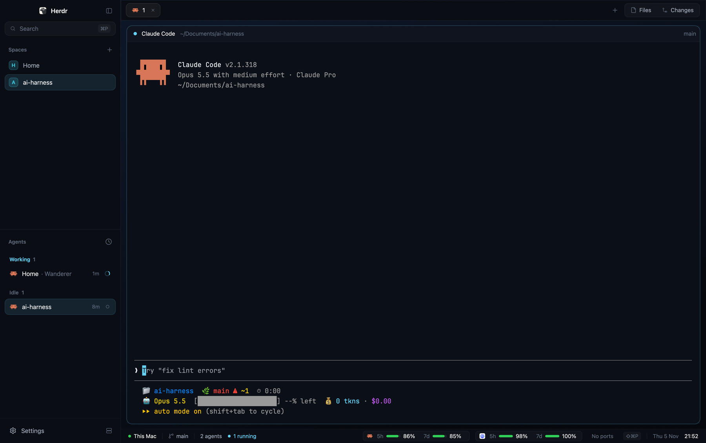

# Neon Pro for Herdr

A calm, Apple-like variant of the Neon layout for [Herdr](https://herdr.dev): system font, macOS system colors, capsule tabs, rounded terminal cards, and a status bar with agent status and the quota left on Claude and Codex.



## Install

Ask your agent inside Herdr to add `github.com/alingavriliuc/herdr-neon-pro`, or copy by hand:

```sh
git clone https://github.com/alingavriliuc/herdr-neon-pro
cd herdr-neon-pro
cp layouts/neon-pro.* ~/.config/herdr-app/layouts/
cp themes/neon-pro.json ~/.config/herdr-app/themes/
cp -R mods/neon-pro-* ~/.config/herdr-app/mods/
herdr-app do layout.switch --name neon-pro
```

`ctrl-shift-l` switches back to your previous layout.

## Quotas in the status bar

- **Claude:** Claude Code only exposes its quota to its status line command. Add the lines in [`extras/claude-statusline-snippet.sh`](extras/claude-statusline-snippet.sh) to your status line script, right after `input=$(cat)` (requires `jq`). It writes `~/.cache/herdr/claude-quota.json`.
- **Codex:** read from your recent sessions in `~/.codex/sessions`. Nothing to set up. opencode signed in with ChatGPT shares this quota.
- A provider with no data shows nothing; data older than 6 hours is dimmed.

## What the mods access

The status bar runs `lsof`/`ps` (dev ports) and reads `~/.cache/herdr/claude-quota.json` and `~/.codex/sessions`. No mod reaches the network.

See [RECIPE.md](RECIPE.md) for the full description.
