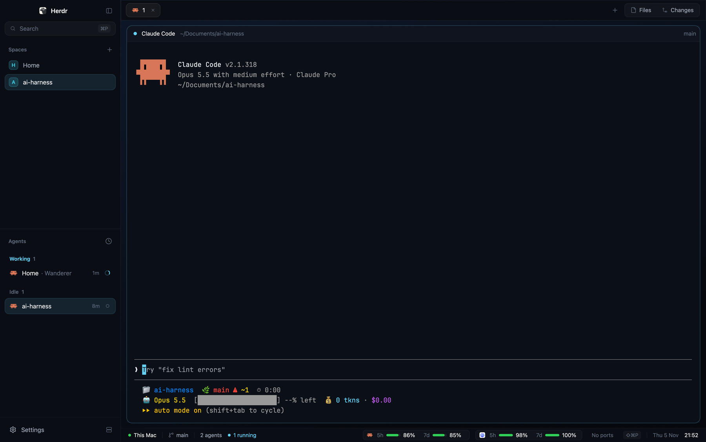

# Neon Pro

A calm, Apple-like take on the Neon layout: a deep navy window with a soft
gradient, a translucent sidebar with tinted space tiles, capsule tabs,
rounded terminal cards with quiet headers, and a status bar that shows each
agent's status plus the quota left on Claude and Codex (5-hour and weekly
windows), all in the system UI font with macOS system colors.

## What you see

- **Window:** no title bar, traffic lights at (12, 16). Background gradient
  `#0d1626` → `#06080d` at 165°. Terminal font "SF Mono" (falls back to the
  default monospace), UI font `.SystemUIFont`, terminal opacity 0.92,
  terminal padding 16×14. Dividers 1px `#ffffff0d`.
- **Theme `neon-pro`:** background `#0b0f17`, foreground `#e8eef5`, cursor and
  accent `#64d2ff`, selection `#1d3a52`. ANSI follows Apple's dark system
  colors (red `#ff453a`, green `#30d158`, yellow `#ffd60a`, blue `#0a84ff`,
  purple `#bf5af2`, cyan `#64d2ff`). Named colors: chrome `#0a0d14`, surface
  `#0f141e`, selected `#16283a`, border `#1e2735`, muted `#98a2b3`, dim
  `#5c677a`, working `#64d2ff`, blocked `#ff453a`, done `#30d158`.
- **Sidebar (left, 256px, `#090c13eb`):**
  - *Header (86px):* a 46px row, padded 82px on macOS to clear the traffic
    lights, with the 18px Herdr logo, "Herdr" in 13px semibold, and a 28px
    sidebar-toggle button. Below it a 30px "Search" field (rounded 9,
    `#ffffff08`, border `#ffffff0f`) with a magnifier and a "⌘P" keycap.
  - *Spaces:* a "Spaces" heading (11px semibold) and a "+" button. Rows are
    34px, rounded 9, each with a letter tile tinted from the space's color
    (fill at 18% alpha, border at 28%, letter in the color). `~` reads
    "Home". The selected row is `accent` at 11% with an `accent` 15% border;
    hover is `#ffffff0a`.
  - *Agents:* the same row style, grouped by status (Working, Needs you,
    Done, Idle) with counts. Each row shows the program icon, the space and
    tab, the time since the last change and a status mark. A "Needs you"
    pill (rounded 9) when an agent is blocked.
  - *Footer (53px):* "Settings" with a gear (plus an accent "Update" pill
    when an update is ready) and a server icon button, "Add a machine".
- **Tabs (44px, `chrome`, bottom border `#ffffff0a`):** the active tab is a
  30px capsule (`#ffffff0f`, border `#ffffff17`, small shadow, medium
  weight); inactive tabs are bare and lighten on hover. Each tab has its
  program icon, its name, a status mark and a round close button (active
  tab and hover only). On the right: "+" and a segmented control with
  "Files" and "Changes" (the active segment `#ffffff17`, icon in accent).
- **Terminals:** cards with radius 12, gap 10, background `#0b0f17`, border
  `#ffffff12`, focused border `#64d2ff59`. The work area is padded 10×12.
  A side panel (368px, hidden at first) holds the shipped `files` and
  `changes` mods.
- **Pane header (34px):** a status dot, the program name, the folder (dim,
  `~`-shortened) and, at the right, the git branch and a status capsule.
- **Status bar (30px, `chrome`, 11.5px):**
  - *Left:* a green dot and "This Mac" (or the machine's name), the branch
    with a branch icon, "N agents", "N running" (cyan dot), "N done" (green
    dot) and a pulsing red "N needs you" pill, separated by 1×12px
    `#ffffff12` hairlines.
  - *Right:* a Claude capsule and a Codex capsule (22px, rounded 7,
    `#ffffff06`, border `#ffffff0d`): the provider's icon, then per window a
    label ("5h", "7d"), a 30×5px bar and the percent left. Then the
    listening dev ports (":3000  :5173", "No ports"), a "⇧⌘P" keycap, the
    date ("Thu 5 Nov", dim) and the time (medium).

## How it behaves

- **Agent status:** working is cyan (a spinner in tabs and the agents list,
  "Running" in the pane capsule); blocked is red and pulses (opacity 0.35 ↔
  1 every 900ms) in tabs, pane capsules and the status bar pill ("Needs
  you"); done is green ("Done"); idle is a dim hollow dot.
- **Clicks:** a space row opens the space; an agent row focuses its
  terminal; Search and ⌘P open the picker; the sidebar button folds the
  sidebar to a rail (76px on macOS) whose rows show only tiles and icons;
  Settings opens settings; the server button opens "Add a machine"; a tab
  click selects it, a double click renames it, dragging reorders, right click
  opens the tab menu, the wheel switches tabs; "+" opens the new-tab menu;
  Files and Changes toggle the side panel (remembered per space); ⇧⌘P opens
  the command palette.
- **Pane header:** split right, split down, zoom and close buttons fade in on
  hover.
- **Quotas:** each meter shows what's *left* (100 − used). Green above 30%,
  yellow at 30% or less, red at 10% or less. A window whose reset time has
  passed shows 100%. The tooltip lists when each window resets. A capsule
  whose data is more than 6 hours old is dimmed, with "run Claude/Codex to
  refresh" in its tooltip. A provider with no data shows no capsule.
- **Refresh:** the clock every 15s, ports every 5s, the Claude quota every
  20s, the Codex quota every 60s.

## Built from

- **Layout tree:** `root` row → `sidebar` column (`brand` block 86px:
  `neon-pro-chrome`; `sidebar-lists` column with `spaces`:
  `neon-pro-spaces` and `agents`: `neon-pro-agents`, weight 1 each, min 90;
  `sidebar-footer` block 53px: `neon-pro-chrome` with `props.footer: true`)
  and `work` column (`tabs` 44px: `neon-pro-tabs`; `work-body` row with
  `main` (active tab, pane header `neon-pro-pane`, 34px, always shown) and
  the hidden `panel` stack of `files` and `changes`; `status` 30px:
  `neon-pro-hud`). `layouts/neon-pro.svg` is the picker preview.
- **Mods:** `neon-pro-chrome`, `neon-pro-spaces`, `neon-pro-agents` and
  `neon-pro-tabs` are restyled clones of the shipped `workspace-chrome`,
  `spaces`, `agents` and `tabs`. `neon-pro-pane` and `neon-pro-hud` are
  new. They use shipped art: `mods/pane/close.svg`,
  `mods/workspace-chrome/*.svg`, `mods/files/file.svg`,
  `mods/changes/changes.svg`, `icons/claude.svg`, `icons/codex.svg`,
  `frame/welcome/herdr.png`.
- **herdr functions:** `spaces()`, `agents()`, `panes()`, `theme()`,
  `layout()`, `window()`, `shared()`, `updates()`, `props()`, `run()`,
  `exec()`, `readTextFile()`, `home()`. Commands: `tab.select`, `tab.move`,
  `tab.rename`, `tab.close`, `layout.resize`, `layout.show`, `layout.hide`,
  `layout.select`, `mod.open` (picker, machine-add), `app.settings`,
  `app.palette`.
- **Programs and files it reads (status bar only):**
  - `lsof` and `ps` for the listening ports (macOS and system apps' ports
    and ports ≥ 49152 are left out).
  - `~/.cache/herdr/claude-quota.json`, which Claude Code's status line
    script writes (see `extras/claude-statusline-snippet.sh`).
  - `sh`, `find`, `grep` over `~/.codex/sessions/**/rollout-*.jsonl` from
    the last 8 days, taking the last line with `payload.rate_limits`.
  - Nothing reaches the network.

## Watch out

- **Claude's quota** only exists in the JSON Claude Code sends to its
  status line command (`rate_limits.five_hour` / `seven_day`, each
  `used_percentage` and `resets_at`). Without the snippet in
  `~/.claude/settings.json`'s `statusLine` script, the Claude capsule stays
  hidden. It needs `jq`.
- **Codex** writes `rate_limits.primary` / `secondary` (`used_percent`,
  `window_minutes`, `resets_at`) into its session logs; the labels come from
  `window_minutes` (300 → 5h, 10080 → 7d). opencode signed in with ChatGPT
  draws on the same quota, so it has no capsule of its own. Gemini keeps
  no local quota data and is not shown.
- **Ports click:** set `props.ports_mod` on the `status` block to the name
  of a mod to open when the ports are clicked; without it the ports are
  display only.
- The percent label needs `w(34)` and `whitespace_nowrap()`, or "100%"
  wraps.
- Clones of shipped mods must rewrite their own asset paths to
  `mods/neon-pro-*/…`; shipped mods are read-only.

## Done when

- `herdr-app check mods/<name>` passes for all six `neon-pro-*` mods.
- `herdr-app do layout.switch --name neon-pro` shows the window above with
  `herdr-app status` reporting no errors.
- Folding the sidebar shows the rail with tiles only; unfolding restores
  the width.
- An agent asking for input pulses red in its tab, its pane capsule and the
  status bar.
- After Claude Code redraws its status line, the Claude capsule appears with
  two meters; hovering it lists both reset times.
